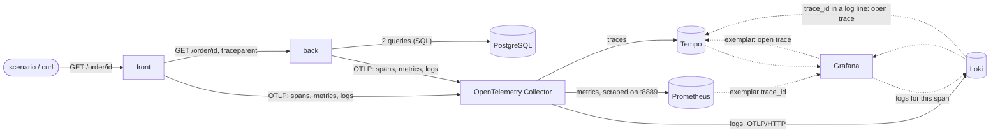

# Architecture

Two small services, a database, one Collector and three backends, all in containers on one laptop. The component names
below are the ones in the lesson's diagram ("The stack you run on your laptop"): front and back (services), PostgreSQL,
the OpenTelemetry Collector, Tempo, Prometheus, Loki, and Grafana reading the three.

## Components and what each owns

| Component | Owns | Does not own |
|---|---|---|
| **front** (`three_signals.interfaces.front_main`) | `GET /order/<id>`; the call to back with a timeout and bounded retries; mapping back's failures to 404, 502 and 504 | any order data |
| **back** (`three_signals.interfaces.back_main`) | `GET /order/<id>`; the two queries; the manual `assemble-order-response` span and the `order_assembly_duration_seconds` histogram; the planted slow query | HTTP calls to anything |
| **PostgreSQL 16** | `orders` and `order_items`, the seed data, a read-only `orders_reader` role the back service connects as | the fault: it only sleeps when asked |
| **OpenTelemetry Collector** (contrib 0.111.0) | receiving OTLP, `memory_limiter` and `batch`, routing each signal to its backend, exposing metrics (with exemplars) for Prometheus to scrape | storing anything |
| **Tempo 2.6.1** | traces, searchable by tag and TraceQL | metrics or logs |
| **Prometheus 2.54.1** | metrics, exemplars (`--enable-feature=exemplar-storage`), the alert rule on slow assemblies | traces |
| **Loki 3.1.1** | logs, with `trace_id` and `span_id` as structured metadata | traces |
| **Grafana 11.2.0** | three provisioned data sources, a dashboard as code; the links between them (exemplar to Tempo, span to Loki, log line to Tempo) | any data |
| **lab tooling** (`three_signals.lab`) | the load scenario and the walk-through that follows a slow request through the three stores; the clients tests use to query them | being imported by the services |

## Data flow

Solid lines are telemetry and requests; dotted lines are what Grafana reads and the links between the data sources.

### One request, step by step

1. `GET /order/3` reaches **front**. The Flask instrumentation (applied by `opentelemetry-instrument`) opens a server
   span and a trace id.
2. Front's `HttpBackClient` calls back with `requests`. The requests instrumentation opens a client span and injects a
   `traceparent` header carrying the trace id and the client span's id.
3. **Back**'s Flask instrumentation reads `traceparent` and opens its server span as a child, so both services' spans
   share one trace id.
4. `AssembleOrder` runs inside `OtelAssemblyTelemetry.measure()`: a child span `assemble-order-response`, and a clock.
5. The repository runs two queries through a connection pool. The psycopg instrumentation turns each into a `SELECT`
   span with `db.statement`. One request in twenty (the planner draws from a seeded generator) asks the second query to
   spend 1.5 seconds inside the database (`pg_sleep`), so that span is the wide one.
6. Before the block ends, `measure()` records the duration in the histogram **inside** the span, so the SDK attaches the
   span's trace id to the sample as an exemplar. The block ends, the span ends, the bucket attribute
   (`order.item_count_bucket`) is on both.
7. Each log call goes to stdout and to the OTLP log exporter as the same JSON line, carrying the current `trace_id`
   and `span_id`.
8. Back answers; front relays the order and adds `X-Trace-Id` to its response (used by the scenario and the tests).
9. Every five seconds the SDKs push metrics; spans and logs go out as they are batched. The Collector's `memory_limiter`
   and `batch` run, then Tempo, Prometheus (scraping `:8889` every five seconds) and Loki receive their signal.
10. In Grafana: the p95 panel shows the spike; the exemplar dot opens the trace in Tempo; "logs for this span" runs
    `{service_name="back"} | trace_id="..."` in Loki; a `trace_id` in a log line is a link back to Tempo.

## The pattern and the layers

Ports and adapters. The domain (`OrderId`, `Order`, `ItemCountBucket`) and the two use cases (`AssembleOrder`,
`FetchOrder`) depend only on Python. Everything they touch is a `Protocol` in `application/ports.py`
(`OrderRepository`, `SlowQueryPlanner`, `AssemblyTelemetry`, `BackClient`) that `infrastructure/` implements with
PostgreSQL, a seeded random generator, OpenTelemetry and `requests`. `interfaces/` holds the HTTP surfaces and the two
composition roots; `lab/` is a sibling of `interfaces/` that only talks to the running stack from outside. `import-linter`
enforces the direction (`make lint`): domain and application may not import Flask, psycopg, requests, OpenTelemetry or
waitress.

This fits because the lesson's system has three boundaries (HTTP in, HTTP out, SQL) and a fault that must be plantable
and replaceable in tests. Every collaborator that a test replaces (the repository, the planner, the telemetry, the back
client, the clock) is injected.

## Decisions and trade-offs

Recorded in `docs/adr/`:

- [0001](docs/adr/0001-opentelemetry-instrument-for-sdk-setup.md): the SDK is configured by `opentelemetry-instrument`
  and `OTEL_*` variables, not by code, so the services hold no exporter or endpoint settings.
- [0002](docs/adr/0002-loki-native-otlp-and-json-log-bodies.md): logs reach Loki through its OTLP endpoint with a JSON
  body, so `trace_id` is both structured metadata and a field in the line.
- [0003](docs/adr/0003-slowness-inside-the-database-statement.md): the planted fault is a `pg_sleep` inside the second
  statement, so the slow span is the `SELECT` span, as in the lesson's trace.
- [0004](docs/adr/0004-one-image-two-services.md): one image, two commands.

Smaller choices: waitress (a pure-Python production WSGI server with one process, so the OpenTelemetry providers are not
forked); `psycopg` 3 with `psycopg_pool`; a pooled, read-only database role; histogram buckets in seconds, because the
SDK default buckets are tuned for milliseconds and would put every request in the first bucket.

## Failure modes the lesson teaches, and where the code shows them

| Failure | How to see it here |
|---|---|
| Propagation broken: three traces instead of one | set `OTEL_PYTHON_REQUESTS_EXCLUDED_URLS=.*` on front and `make up` again: the requests instrumentation stops injecting `traceparent`, and back's spans start a new trace |
| Both queries slow: no single culprit | edit `_HEADER_SQL` the way `_ITEMS_SQL` is built (a `CROSS JOIN pg_sleep`) and the trace has two wide spans |
| Plain-text logs: the trace id is buried | replace `JsonFormatter` with a `%(message)s` formatter: the Loki line no longer parses with `| json`, and the `trace_id` filter can only match inside text |
| A raw id as a metric label | `order_assembly_duration_seconds` takes only the four-valued `order.item_count_bucket`; the order id is available on the span and in the log line |
| A container is up but Grafana cannot query it | `make health` queries each data source through Grafana's own API, not just the container state |

## Limits of the teaching build against a production one

- One of each component, local disk storage, no authentication, no TLS between any two components; every port is bound
  to loopback.
- The Collector is one process with no persistent queue: a restart loses what was in its memory. Before production: TLS
  and bearer-token authentication on the OTLP receivers, a `file_storage`-backed sending queue on each exporter, and
  `memory_limiter` limits sized against the real traffic (they are 384 MiB here).
- Every trace is kept (no sampling) and every exemplar is stored; project 3 adds tail sampling.
- Prometheus retention is two days and Tempo keeps 24 hours.
- The fault is a feature of the production code path, switched by environment variables; a real system would inject
  faults from outside (a proxy, a chaos tool).

## How to extend it

- A profiler: add a `pyroscope` or Parca container and link a span to it from Tempo's `tracesToProfiles` setting.
- A queue between the services: propagate `traceparent` in message headers and start the consumer's span as a link.
- Resource attributes for environment and version are already set (`OTEL_RESOURCE_ATTRIBUTES`); add them as variables in
  the dashboard's `templating` list to filter by them.
- A new metric: add the instrument in `OtelAssemblyTelemetry` (or a sibling adapter), keep its attributes bounded, and
  extend the dashboard JSON; `tests/observability` fails if a panel queries a metric nothing produces.
