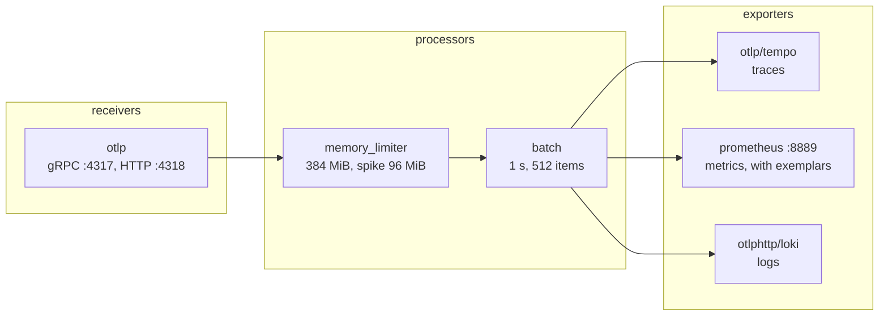

# observability-three-signals

Two small services (a front that calls a back that queries PostgreSQL), instrumented with OpenTelemetry and sending traces, metrics and logs through one Collector to Tempo, Prometheus and Loki, with Grafana following a latency spike to its trace and its log lines.

| | |
| --- | --- |
| **Lesson** | `/prep/observability/project-three-signals`, "Instrument two services and follow one slow request" (`data-structure-explainer/src/content/tracks/observability/12-project-three-signals.md` in the Plainround app) |
| **Planned hours** | 6 |
| **Level** | Beginner |
| **Architecture** | [ARCHITECTURE.md](ARCHITECTURE.md), decisions in [docs/adr](docs/adr) |

## Prerequisites

| Tool | Version | Used for |
| --- | --- | --- |
| Docker with Compose v2 | 24 or newer (tested with 24.0.6 and Compose v2.23) | the whole stack |
| Python | 3.12 or 3.13 (tested with 3.13; the CI and the image use 3.12) | the tests and the lab commands on your machine |
| GNU Make | 3.81 or newer (the one on macOS works) | every command below |
| Images | `postgres:16.4-alpine`, `otel/opentelemetry-collector-contrib:0.111.0`, `grafana/tempo:2.6.1`, `prom/prometheus:v2.54.1`, `grafana/loki:3.1.1`, `grafana/grafana:11.2.0` (the versions the lesson names; `python:3.12.8-slim-bookworm` is the base of the service image) | pulled by Docker on first `make up` |
| Python packages | Flask, waitress, psycopg 3, requests and the OpenTelemetry distro, exporters and instrumentations (Flask, requests, psycopg) at run time; pytest, pytest-cov, ruff, mypy, import-linter, pip-audit for development. All pinned with hashes in `requirements.lock` and `requirements-dev.lock`; `make` installs them into `.venv/` | everything |

No cloud account, no secrets. The values in `.env.example` are local-only placeholders; `make up` copies them to `.env`. The stack needs about 2 GB of memory for Docker. Every port is bound to `127.0.0.1`; the defaults are Grafana 23000, Prometheus 29090, Tempo 23200, Loki 23100, the Collector's OTLP/HTTP 24318 and health 23133, and the front service 28081. Change any of them in `.env` if the port is taken.

## Setup, run, test, stop

```bash
make up                 # builds the image, starts everything, loads sql/001 and sql/002, waits until healthy, checks all three data sources
make run                # 600 requests at 10 a second, then the click path from the p95 spike to the slow span's log lines
make follow             # the click path alone, from whatever traffic is already in the stores
make health             # every container, every backend, and Grafana querying Tempo, Prometheus and Loki
make queries            # sql/003_queries.sql: the lesson's queries, including the slow one
make check              # format check, lint, types, import rules, unit tests with coverage, promtool config and rule tests
make test-integration   # the stack's parts and the database (needs make up first)
make test-e2e           # the lesson's steps against the stores (needs make up first)
make audit              # known-vulnerability check of the locked dependencies
make down               # stops everything and deletes its data
```

`make help` lists every target. Open Grafana at <http://localhost:23000> (user `admin`, password `GRAFANA_ADMIN_PASSWORD` from `.env`) and the dashboard "Three signals" to do the walk by hand; `make follow` does the same clicks through the stores' APIs and prints them.

What `make up` ends with, and what `make run` prints (trace ids, times and the exact slow request vary; this run was on a heavily loaded laptop, so every absolute time is larger than yours will be, and the planted 1.5 s fault is smaller than the noise around it):

```text
$ make health
ok   front /healthz
ok   collector health_check
ok   tempo /ready
ok   prometheus /-/healthy
ok   loki /ready
ok   grafana queries prometheus: Successfully queried the Prometheus API.
ok   grafana queries tempo: Tempo answered 200 through Grafana's proxy
ok   grafana queries loki: Data source successfully connected.

$ make run
sent 240 requests in 79.9s: 0 failed, 58 slow (>= 1 s), median 323 ms, p95 5431 ms
1. Latency panel: p95 peaks at 10000 ms at 01:56:11.
2. Click the exemplar dot: trace 10451fca938a3ac49d7eefe8f4c734a5, a 10754 ms assembly.
3. The trace spans back, front with 6 spans; the widest database span is 'SELECT' at 535 ms (SELECT oi.id, oi.sku, oi.quantity, oi.unit_price_cents FROM order_items AS oi CROSS JOIN pg_sleep(%(delay_seconds)s) WHERE oi.order_id = %(order_id)s ORDER BY oi.id).
4. Click 'logs for this span': 3 lines carry trace_id=10451fca938a3ac49d7eefe8f4c734a5:
     {"timestamp": "2026-10-27T01:55:48.813+00:00", "level": "info", "msg": "order_items query started", ..., "trace_id": "10451fca...", "span_id": "a2938fc74b0eaef6", "order_id": 332}
     {"timestamp": "2026-10-27T01:55:57.172+00:00", "level": "warning", "msg": "slow query finished", ..., "trace_id": "10451fca...", "span_id": "a2938fc74b0eaef6", "order_id": 332, "duration_ms": 2338}
     {"timestamp": "2026-10-27T01:55:57.510+00:00", "level": "info", "msg": "order assembled", ..., "trace_id": "10451fca...", "span_id": "f3e49090ed18b2ba", "order_id": 332, "item_count": 5, "bucket": "3-5"}
5. Back the other way: the first log line's trace_id is 10451fca938a3ac49d7eefe8f4c734a5, the same trace.
```

The lesson's expected output on a quiet machine is a p95 flat near 8 ms with a spike to about 1,500 ms, a `SELECT order_items` span of about 1,500 ms and two log lines for it; this run could not show that cleanly because the host was saturated (load average above 50 on a 12-core Mac). The walk opens exemplar traces from the slowest down until one has a database span over a second wide, so a request that was slow only because the machine was busy is skipped.


## Done when: the lesson's checklist and the proof for each line

| # | Done when (from the lesson) | Command | What proves it |
| --- | --- | --- | --- |
| 1 | All containers are healthy and the dashboard tool can query all three backends. | `make up` (ends with `make health`), or `make health` alone | `docker compose ps` shows postgres, tempo, prometheus, loki, grafana, back and front healthy (the Collector image has no shell, so it has no health check; its `health_check` extension on :13133 is probed instead). `make health` prints `ok` for each backend and for Grafana querying Prometheus, Loki, and Tempo (through Grafana's data source proxy, because Grafana 11.2 has no backend health check for Tempo). `tests/integration/test_stack.py::test_grafana_can_query_tempo_prometheus_and_loki` asserts the same. |
| 2 | One request produces a single trace with spans from both services and the database call, joined by propagated context. | `curl -i http://localhost:28081/order/3` (the `X-Trace-Id` header), then open the trace in Grafana Explore with the Tempo data source, or `make run` and `make follow` | One trace id, six spans, one root, every parent present (below). `tests/e2e` step 2 asserts: spans from `front` and `back`, exactly two `SELECT` spans, one root, every parent in the trace. |
| 3 | The span appears inside the trace with its attribute, and the histogram's p95 shows on a dashboard panel. | Open the dashboard "Three signals", panel "Order assembly p95 (seconds)"; or query Prometheus | `assemble-order-response` is a child of back's server span and carries `order.item_count_bucket` (`1-2` below). `histogram_quantile(0.95, sum by (le) (rate(order_assembly_duration_seconds_bucket[1m])))` returns a series; the panel plots it and shows exemplar dots. `tests/e2e` step 3 asserts the attribute and a positive p95; `tests/unit/infrastructure/test_otel_telemetry.py` asserts the exemplar carries the span's trace id. |
| 4 | From a span you can find exactly its log lines, and from a log line you can open its trace. | Loki: `{service_name="back"} \| trace_id="<id>"` (or `\| json \| trace_id="<id>"`). Grafana: the span's "Logs for this span" link; a log line's "Open trace" link | The query returns the two or three JSON lines of that request, all with that `trace_id` and `span_id`s that exist in the trace, and none from another trace. The Tempo data source's `tracesToLogsV2` and the Loki data source's `derivedFields` are provisioned in `observability/grafana/provisioning/datasources`. `tests/e2e` step 4 asserts both directions, including that the structured-metadata `trace_id` and the JSON body's `trace_id` agree. |
| 5 | You go from the spike to an exemplar or a matching trace, to the slow span, to its log lines, and write down each click. | `make run` (or `make follow` after any traffic) | The transcript above is the click list: the p95 spike, the exemplar's trace, the wide `order_items` span, the span's log lines, and the log line's trace id leading back to the same trace. In Grafana: panel "Order assembly p95", click an exemplar dot on the spike, Tempo opens the trace, click the wide `SELECT` span, "Logs for this span". `tests/e2e` step 5 asserts the exemplar value, a database span of at least 1,000 ms mentioning `order_items`, the `slow query finished` line and the round trip. |
| 6 | The README's diagram shows receivers, processors and exporters, and names one thing you would add before production. | read the next section | The pipeline diagram below, and the named addition: TLS and authentication on the OTLP receivers plus a disk-backed exporter queue (with the reason). `memory_limiter` is already in the pipeline. |

One request, one trace (step 2 and 3; from `tests/e2e`'s data, copied from Tempo):

```text
trace 13c738f757cc45b298bbc9b98eb03c62
front: GET /order/<int:order_id> (242 ms)                     http.target=/order/398
  front: GET (74 ms)                                           http.url=http://back:8081/order/398
    back: GET /order/<int:order_id> (5 ms)
      back: assemble-order-response (4 ms)                     order.item_count_bucket=1-2
        back: SELECT (1 ms)                                    SELECT id, customer_name FROM orders WHERE id = %(order_id)s
        back: SELECT (1 ms)                                    SELECT oi.id, oi.sku, oi.quantity, oi.unit_price_cents FROM order_items ...
```


### The Collector pipeline (lesson step 6)

Every Collector configuration is three stages per signal: receivers, processors, exporters (`observability/collector/config.yaml`).



The same two processors run in the `traces`, `metrics` and `logs` pipelines. **What to add before production:** TLS and bearer-token authentication on the OTLP receivers, because anything that can reach port 4318 can write telemetry, and a `file_storage`-backed sending queue on each exporter, because without it the Collector loses whatever is in memory when it restarts or a backend is down for longer than the retry window. `memory_limiter` and `batch` are already in place; their limits (384 MiB) should be sized against real traffic.


## Stretch goals

| Stretch (from the lesson) | Built? |
| --- | --- |
| Add a continuous profiler and link a slow span to the code that was running. | No. [ARCHITECTURE.md](ARCHITECTURE.md#how-to-extend-it) says where it would go (a profiler container and Tempo's `tracesToProfiles` link). |
| Propagate context through a message queue between the services and keep one trace across it. | No. The Kafka track's repositories show the broker side; the extension is described in the architecture notes. |
| Add resource attributes for the environment and deployment version, and filter the dashboard by them. | Half. `service.version` and `deployment.environment` are set on both services (`OTEL_RESOURCE_ATTRIBUTES`) and reach Prometheus as labels; the dashboard has no variable that filters by them yet. |

## What is simplified for teaching

Only what the lesson scopes out, plus where this build differs from the lesson's text:

- One of every component with local disk storage, no authentication and no TLS between components; ports bound to loopback. The Collector has a `memory_limiter` and `batch` already; what to add before production is TLS and authentication on the OTLP receivers and a disk-backed exporter queue ([ARCHITECTURE.md](ARCHITECTURE.md#limits-of-the-teaching-build-against-a-production-one)).
- Every trace is kept and exemplars are stored without limits (project 3 does sampling).
- The planted fault is production code behind `SLOW_QUERY_PROBABILITY`; a real system would inject faults from outside.
- The lesson's starting-point Collector sends logs with the `loki` exporter. In Collector 0.111.0 that exporter's stability for logs is `Deprecated` (`otelcol-contrib components` says so), and Loki ingests OTLP natively since 3.0, so logs go through `otlphttp` to Loki's `/otlp` endpoint ([ADR 0002](docs/adr/0002-loki-native-otlp-and-json-log-bodies.md)).
- The lesson sleeps before the `order_items` query; here the delay is inside the SQL statement so the slow span is the `SELECT` span, as the lesson's expected trace shows ([ADR 0003](docs/adr/0003-slowness-inside-the-database-statement.md)).
- The lesson's trace shows spans named `SELECT orders` and `SELECT order_items`; the psycopg instrumentation names both `SELECT` and records the statement in `db.statement`, which is what the walk-through reads.
- `opentelemetry-instrument` configures the SDK from `OTEL_*` variables as the lesson suggests, but the services run on waitress (one process, threads) rather than a pre-forking server, because the exporters' threads do not survive a fork ([ADR 0001](docs/adr/0001-opentelemetry-instrument-for-sdk-setup.md)).
- One image runs both services ([ADR 0004](docs/adr/0004-one-image-two-services.md)); the lesson builds `./front` and `./back` separately.
- The `back` service connects as a read-only database role (`orders_reader`) that `sql/001_schema.sql` creates, not as the superuser the lesson's connection string uses.

## Project structure

```text
src/three_signals/
  domain/            OrderId, Order, OrderItem, ItemCountBucket, named errors.
                     Depends on nothing outside the standard library.
  application/       use cases (AssembleOrder for back, FetchOrder for front) and the ports they need
                     (OrderRepository, SlowQueryPlanner, AssemblyTelemetry, BackClient). Depends on domain only.
  infrastructure/    adapters: PostgreSQL repository, HTTP client to back (timeouts, retries with backoff), the planted
                     fault, the OpenTelemetry span and histogram, JSON logging with trace ids, settings (environment,
                     validated), signal handling. Depends on application and domain.
  interfaces/        the two Flask apps, the waitress runner, the composition roots (front_main, back_main) and the
                     health command. Depends on everything below; nothing depends on it.
  lab/               the scenario (load), the clients that query Tempo, Prometheus, Loki and Grafana, and the walk-through
                     that follows a slow request. A sibling of interfaces; the services never import it.
tests/
  unit/              domain, application (with fakes), infrastructure, interfaces, lab. No containers.
  observability/     lints compose, the Collector, Prometheus, Loki, the data sources and the dashboard.
  integration/       the running stack: data sources, the database and its role, the services.
  e2e/               the lesson's steps against Tempo, Prometheus and Loki.
sql/                 001_schema.sql (DDL, role), 002_seed.sql (DML: 1,000 orders, 3,000 items), 003_queries.sql.
observability/       the Collector, Tempo, Prometheus (config, alert rule, promtool replay test), Loki and Grafana
                     (data sources, dashboard) as code.
docs/adr/            decision records.
docker-compose.yml   the stack.               Dockerfile  the service image (non-root, base image pinned by digest).
pyproject.toml       project metadata and every tool's configuration (ruff, mypy, pytest, import-linter).
requirements*.lock   hash-pinned dependencies (runtime, and runtime plus development tools).
Makefile             the only commands a reader needs (make help).
```

The dependency rule (domain depends on nothing; application on domain; infrastructure on both; interfaces and lab on everything; nothing on them) is enforced by `make lint` through import-linter. A second contract forbids `domain` and `application` from importing Flask, psycopg, requests, OpenTelemetry or waitress.

## Troubleshooting

- **A port is in use:** change the matching `*_HOST_PORT` in `.env` and run `make up` again.
- **`make up` times out or a container is "unhealthy" on a busy machine:** the health checks wait up to ten minutes per container; Grafana's first start migrates its database and is the slowest. `docker compose ps` shows what is still starting.
- **`make follow` says the trail went cold:** the exemplar needs a slow request, a metric export (5 s) and a scrape (5 s). Run `make run` first, or raise `SLOW_QUERY_PROBABILITY` in `.env`.
- **Start clean:** `make down && make up` (the volumes are deleted).

## Author and license

Written by Sumit Srivastava. Released under the MIT License, see [LICENSE](LICENSE). Changes are in [CHANGELOG.md](CHANGELOG.md).
